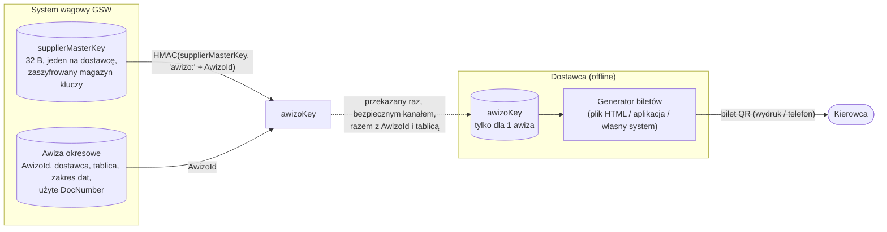
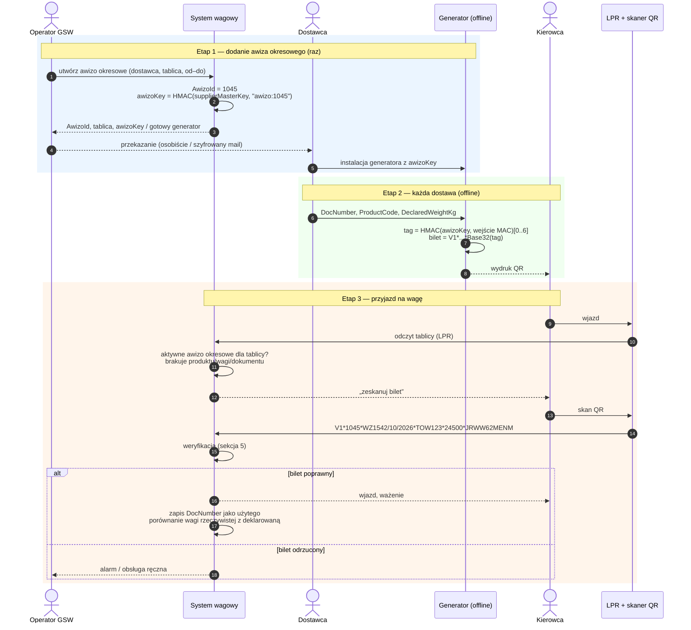
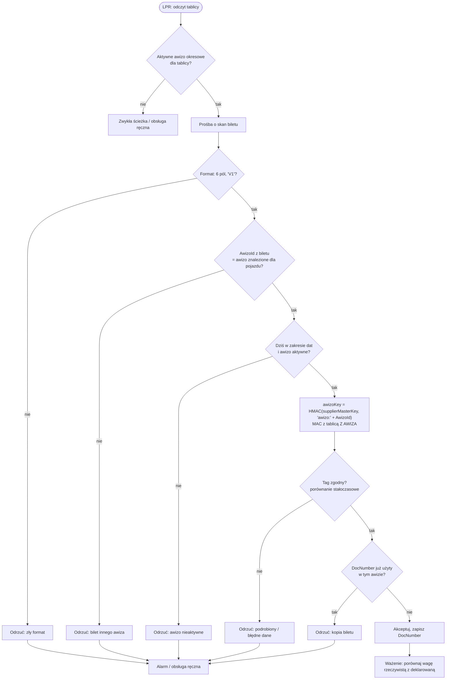
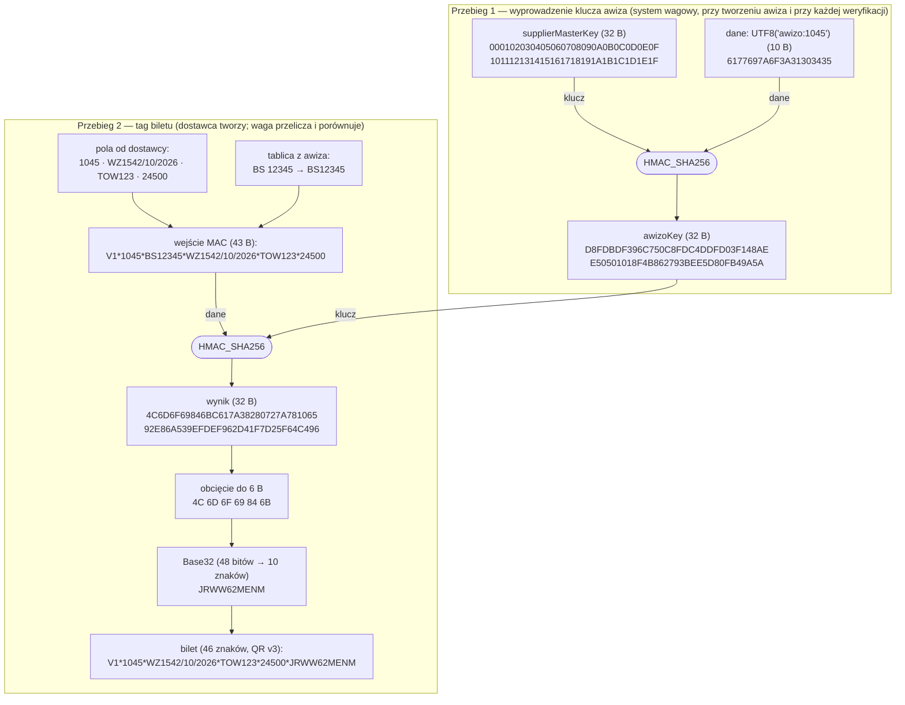
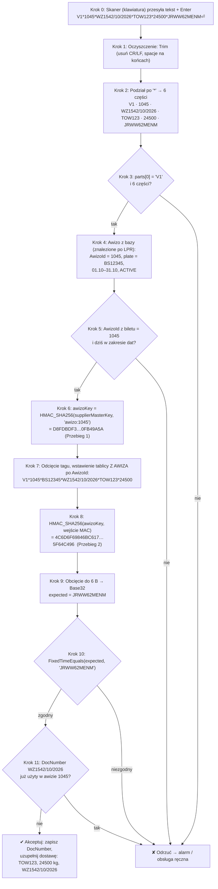
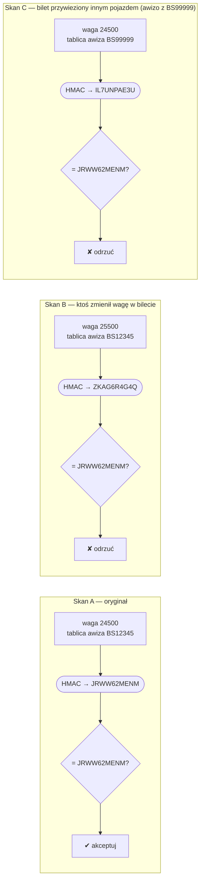

# Awizacja okresowa — przepływ (wariant 9)

Bilet QR `V1` uwierzytelniony obciętym HMAC-SHA256, kodowany w trybie QR alphanumeric.
Format i zasady: [README](../README.md#awizacja-okresowa-wariant-9). Opis tekstowy krok po kroku: [proces-krok-po-kroku.md](proces-krok-po-kroku.md).
Implementacja referencyjna: [AwizoTicket.cs](../AwizoTicket.cs).

Jednostką jest **awizo** (`AwizoId`, liczba całkowita), nie umowa — umowa nie istnieje w systemie, a jednej umowie może odpowiadać wiele awiz.
Każdy dostawca ma własny `supplierMasterKey`, każde awizo okresowe ma własny klucz `awizoKey`.

## 1. Klucze — co jest gdzie



- `supplierMasterKey` nigdy nie opuszcza systemu wagowego.
- `awizoKey` nie jest zapisywany po stronie GSW — zawsze można go przeliczyć.
- Wyciek `awizoKey` = możliwość podrobienia biletów tylko dla tego jednego awiza.

## 2. Przebieg end-to-end



## 3. Etap 1 — dodanie awiza okresowego (system wagowy)

```text
function AddPeriodicAwizo(supplierId, plate, validFrom, validTo, freeText):
    awizoId  = NextAwizoId()                               // liczba całkowita, np. 1045
    awizo    = { awizoId, supplierId,
                 plate: NormalizePlate(plate),             // "BS 12345" -> "BS12345"
                 validFrom, validTo,
                 note: freeText,                           // np. numer umowy, jeśli ktoś wpisze — nie bierze udziału w kryptografii
                 status: ACTIVE, usedDocNumbers: {} }
    db.Save(awizo)

    supplierMasterKey = keyStore.GetSupplierMasterKey(supplierId)
    awizoKey = HMAC_SHA256(supplierMasterKey, UTF8("awizo:" + ToString(awizoId)))
    // awizoKey NIE jest zapisywany w bazie

    return SupplierPackage {
        awizoId,
        plate:    awizo.plate,
        awizoKey: Hex(awizoKey),                           // albo generator HTML z wbudowanym kluczem
        spec:     "README: Format biletu V1 + wektor testowy"
    }
```

## 4. Etap 2 — generowanie biletu (dostawca, offline)

```text
// Konfiguracja generatora (otrzymana raz):  awizoId, plate, awizoKey
function CreateTicket(docNumber, productCode, weightKg):
    fields = [ "V1",
               ToString(awizoId),                          // "1045" — bez zer wiodących
               Upper(docNumber),                           // np. "WZ1542/10/2026"
               Upper(productCode),                         // np. "TOW123"
               ToString(weightKg) ]                        // liczba całkowita, np. "24500"
    Require(text fields use only "0-9 A-Z space $ % + - . / :")

    macInput = Join("*", [ fields[0], fields[1], NormalizePlate(plate), fields[2], fields[3], fields[4] ])
             // "V1*1045*BS12345*WZ1542/10/2026*TOW123*24500"

    tag      = HMAC_SHA256(awizoKey, UTF8(macInput))[0..6]
    ticket   = Join("*", fields + [ Base32_NoPadding(tag) ])
             // "V1*1045*WZ1542/10/2026*TOW123*24500*JRWW62MENM"

    return QrCode(ticket, ecc: M)                          // biblioteka wybierze tryb alphanumeric
```

Przeglądarkowy generator offline (szkic):

```js
const key = await crypto.subtle.importKey("raw", hexToBytes(AWIZO_KEY),
                                          { name: "HMAC", hash: "SHA-256" }, false, ["sign"]);
const macInput = [fields[0], fields[1], PLATE, ...fields.slice(2)].join("*");
const mac = new Uint8Array(await crypto.subtle.sign("HMAC", key, new TextEncoder().encode(macInput)));
const ticket = fields.join("*") + "*" + base32(mac.slice(0, 6));
```

## 5. Etap 3 — weryfikacja na wadze



```text
function OnTicketScanned(lprPlate, ticket):
    awizo = db.FindActivePeriodicAwizoByPlate(lprPlate, tolerance: FUZZY)   // błąd LPR obsługiwany tutaj
    if awizo == null:                                   return Reject("brak awiza okresowego")

    parts = Split(Trim(ticket), "*")
    if parts.Length != 6 or parts[0] != "V1":           return Reject("zły format")
    [ver, awizoId, docNumber, productCode, weightKg, tag] = parts

    if awizoId != ToString(awizo.awizoId):              return Reject("bilet innego awiza")
    if not (awizo.validFrom <= Today <= awizo.validTo)
       or awizo.status != ACTIVE:                       return Reject("awizo nieaktywne")

    supplierMasterKey = keyStore.GetSupplierMasterKey(awizo.supplierId)
    awizoKey = HMAC_SHA256(supplierMasterKey, UTF8("awizo:" + awizoId))
    macInput = Join("*", [ver, awizoId, awizo.plate, docNumber, productCode, weightKg])
             // pola biletu bez tagu + tablica z AWIZA (nie z odczytu LPR) wstawiona po awizoId
    expected = Base32_NoPadding(HMAC_SHA256(awizoKey, UTF8(macInput))[0..6])
    if not FixedTimeEquals(expected, tag):              return Reject("niepoprawny tag")

    if docNumber in awizo.usedDocNumbers:               return Reject("bilet już użyty")
    awizo.usedDocNumbers.Add(docNumber)                 // atomowo, razem z otwarciem ważenia

    return Accept(delivery: { awizo, docNumber, productCode, declaredWeightKg: weightKg })
```

## 6. HMAC_SHA256 krok po kroku — przykładowe przebiegi

Wartości z wektora testowego (`supplierMasterKey = 00 01 02 … 1F`). Można je odtworzyć laboratorium (`SupplierMasterKeyHex` w `LabConfig.cs`)
lub dowolną biblioteką HMAC-SHA256 — dostawcy mogą tym sprawdzić własną implementację krok po kroku.



### Przebieg 1 — wyprowadzenie `awizoKey`

```text
> awizoKey = HMAC_SHA256(key = supplierMasterKey, data = UTF8("awizo:1045"))

  key   = 000102030405060708090A0B0C0D0E0F101112131415161718191A1B1C1D1E1F   (32 B)
  data  = 61 77 69 7A 6F 3A 31 30 34 35                                      (10 B, "awizo:1045")
  ----
  awizoKey = D8FDBDF396C750C8FDC4DDFD03F148AEE50501018F4B862793BEE5D80FB49A5A
```

### Przebieg 2 — tag biletu, z wnętrzem HMAC

HMAC to dwa wywołania SHA-256: `HMAC(K, m) = SHA256( (K ⊕ opad) ‖ SHA256( (K ⊕ ipad) ‖ m ) )`,
gdzie `K` to klucz dopełniony zerami do 64 B, `ipad = 0x36…`, `opad = 0x5C…`.

```text
> tag = HMAC_SHA256(key = awizoKey, data = UTF8("V1*1045*BS12345*WZ1542/10/2026*TOW123*24500"))

  K         = D8FDBDF3…0FB49A5A ‖ 00 × 32                                      (64 B)
  K ⊕ ipad  = EECB8BC5A0F166FECBF2EBCB35C77E98…                                (64 B)
  K ⊕ opad  = 84A1E1AFCA9B0C94A19881A15FAD14F2…                                (64 B)

  inner = SHA256( K⊕ipad ‖ data )
        = 79E2947AADC34E458E85CE415DA975A6E31FB52A283F724682E061717A5CB461
  outer = SHA256( K⊕opad ‖ inner )
        = 4C6D6F69846BC617A38280727A78106592E86A539EFDEF962D41F7D25F64C496   ← wynik HMAC

  [0..6]   = 4C 6D 6F 69 84 6B
  bity     = 01001 10001 10110 10110 11110 11010 01100 00100 01101 011(00)
  indeksy  =   9    17    22    22    30    26    12     4    13    12
  Base32   =   J     R     W     W     6     2     M     E     N     M      → "JRWW62MENM"
```

### Przebieg 3 — odczyt i weryfikacja biletu na wadze, krok po kroku

Waga **nie odszyfrowuje** tagu — HMAC jest jednokierunkowy. Waga liczy tag jeszcze raz z tych samych danych
(pola z biletu + tablica z awiza + `awizoKey` odtworzony z `supplierMasterKey`) i sprawdza, czy wyszedł identyczny.



```text
> raw = ScannerRead()
  raw = "V1*1045*WZ1542/10/2026*TOW123*24500*JRWW62MENM\r\n"

> ticket = Trim(raw)
  ticket = "V1*1045*WZ1542/10/2026*TOW123*24500*JRWW62MENM"            (46 znaków)

> parts = Split(ticket, "*")
  parts[0] ver          = "V1"                ✔ znana wersja
  parts[1] awizoId      = "1045"              ✔ liczba całkowita
  parts[2] docNumber    = "WZ1542/10/2026"
  parts[3] productCode  = "TOW123"
  parts[4] weightKg     = "24500"             ✔ liczba całkowita
  parts[5] tag          = "JRWW62MENM"        ✔ 10 znaków A-Z2-7
  parts.Length          = 6                   ✔

> awizo = db.FindActivePeriodicAwizoByPlate(lprPlate = "BS12346")   // LPR pomylił ostatnią cyfrę
  awizo = { awizoId: 1045, supplierId: 77, plate: "BS12345", validFrom: 2026-10-01, validTo: 2026-10-31, status: ACTIVE }
          // dopasowanie z tolerancją; do MAC idzie awizo.plate, więc błąd LPR nie psuje weryfikacji

> awizoId == ToString(awizo.awizoId)          "1045" == "1045"                   ✔
> validFrom <= Today <= validTo               2026-10-01 <= 2026-10-19 <= 2026-10-31   ✔

> supplierMasterKey = keyStore.GetSupplierMasterKey(77)
> awizoKey = HMAC_SHA256(supplierMasterKey, UTF8("awizo:1045"))
  awizoKey = D8FDBDF396C750C8FDC4DDFD03F148AEE50501018F4B862793BEE5D80FB49A5A

> macInput = Join("*", [ver, awizoId, awizo.plate, docNumber, productCode, weightKg])
  macInput = "V1*1045*BS12345*WZ1542/10/2026*TOW123*24500"

> mac      = HMAC_SHA256(awizoKey, UTF8(macInput))
  mac      = 4C6D6F69846BC617A38280727A78106592E86A539EFDEF962D41F7D25F64C496
> expected = Base32_NoPadding(mac[0..6]) = Base32(4C 6D 6F 69 84 6B) = "JRWW62MENM"

> FixedTimeEquals(expected, tag)
  expected  J R W W 6 2 M E N M
  tag       J R W W 6 2 M E N M
            ✔ wszystkie 10 znaków zgodne     (porównywane są zawsze wszystkie znaki, bez wczesnego wyjścia)

> "WZ1542/10/2026" in awizo.usedDocNumbers    → nie                              ✔
> awizo.usedDocNumbers.Add("WZ1542/10/2026")  // atomowo z otwarciem ważenia

> Accept → dostawa: awizo 1045, BS12345, TOW123, deklarowane 24500 kg, dokument WZ1542/10/2026
```

Równoważnie zamiast kodować `expected` do Base32 można zdekodować tag z biletu do bajtów
(`Base32Decode("JRWW62MENM") = 4C 6D 6F 69 84 6B`) i porównać 6 bajtów z `mac[0..6]` — wynik ten sam.

Dlaczego porównanie stałoczasowe: zwykłe `==` kończy na pierwszej różnicy, więc czas odpowiedzi zdradzałby,
ile początkowych znaków tagu jest poprawnych. Przy wadze (fizyczny skan) to ryzyko teoretyczne, ale koszt jest zerowy.

### Przebieg 4 — weryfikacja na wadze: trzy skany

Waga zawsze liczy tag od nowa z danych z biletu i **tablicy z awiza**, potem porównuje z tagiem z biletu.



```text
> A: bilet  V1*1045*WZ1542/10/2026*TOW123*24500*JRWW62MENM,  awizo.plate = BS12345
     macInput = V1*1045*BS12345*WZ1542/10/2026*TOW123*24500
     expected = JRWW62MENM   tag z biletu = JRWW62MENM   → ZGODNY

> B: bilet  V1*1045*WZ1542/10/2026*TOW123*25500*JRWW62MENM,  awizo.plate = BS12345
     macInput = V1*1045*BS12345*WZ1542/10/2026*TOW123*25500
     expected = ZKAG6R4G4Q   tag z biletu = JRWW62MENM   → NIEZGODNY (zmiana 1 znaku zmienia cały tag)

> C: ten sam bilet co A, ale awizo.plate = BS99999
     macInput = V1*1045*BS99999*WZ1542/10/2026*TOW123*24500
     expected = IL7UNPAE3U   tag z biletu = JRWW62MENM   → NIEZGODNY
     (w praktyce odrzucony już wcześniej: AwizoId z biletu ≠ awizo znalezione dla tego pojazdu)
```

## 7. Co chroni przed czym

| Zagrożenie | Ochrona |
|---|---|
| Ręcznie wymyślony / zmieniony bilet | tag HMAC (1 : 2⁴⁸ na próbę, próby tylko fizycznie przy wadze) |
| Przesunięcie znaków między polami (np. z numeru dokumentu do kodu produktu) | separator `*` w wejściu MAC; `*` niedozwolony w polach |
| Bilet z awiza A użyty dla pojazdu z awiza B | `AwizoId` musi zgadzać się z awizem pojazdu; tablica z awiza w MAC |
| Skopiowany QR (druga dostawa na ten sam bilet) | unikalność `DocNumber` w awizie |
| Bilet po końcu okresu awiza | zakres dat / status awiza w systemie |
| Wyciek `awizoKey` od dostawcy | szkoda ograniczona do 1 awiza; zablokuj je i wystaw nowe awizo (nowy `AwizoId`) |
| Zawyżona / zaniżona deklarowana waga | ważenie rzeczywiste |
| Wyciek `supplierMasterKey` | poważne, ale tylko dla jednego dostawcy — nowy klucz główny dostawcy, nowe awiza i klucze dla jego aktywnych awiz |
